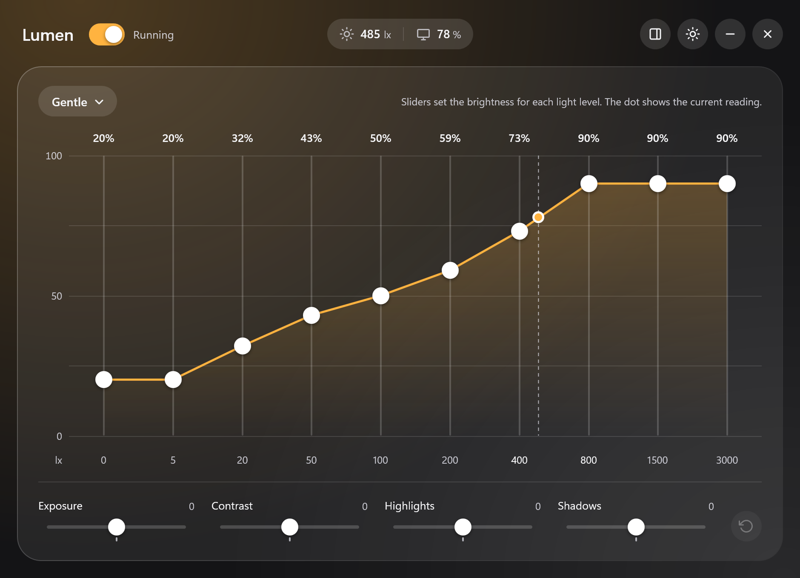
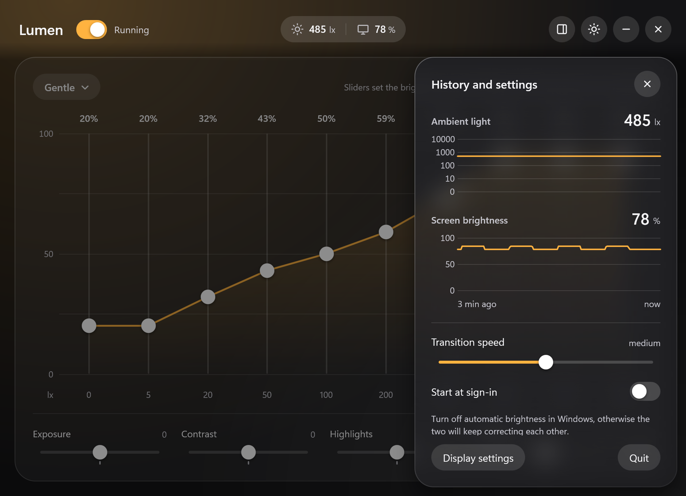
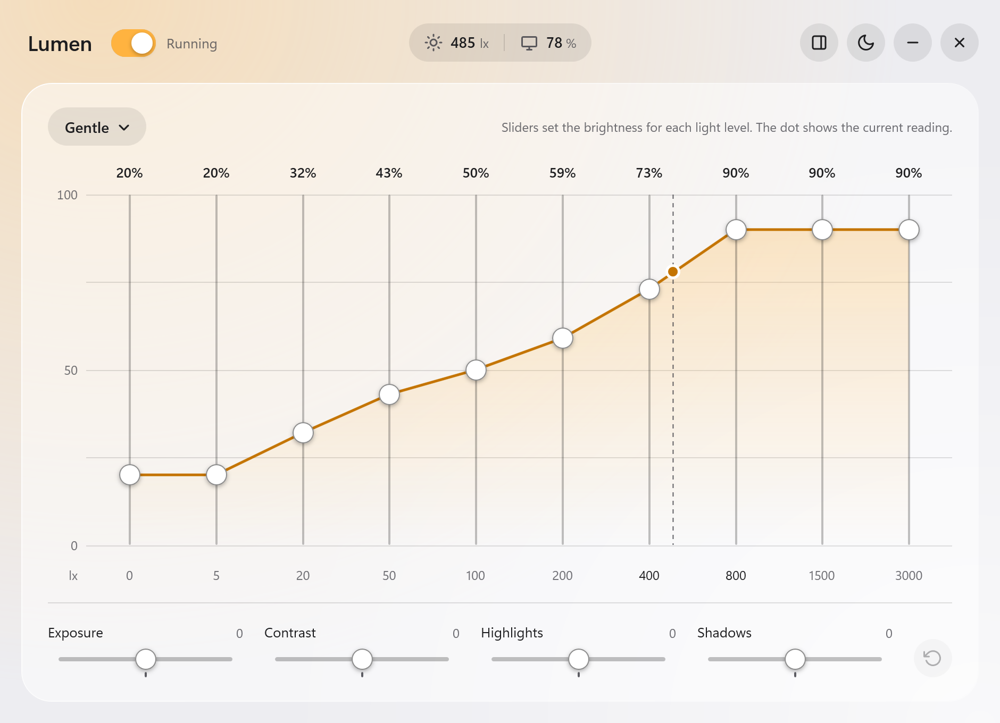

# Lumen

Automatic screen brightness for Windows laptops, driven by a curve you shape yourself.

[](https://github.com/hubert-rutkowski/lumen/releases/latest)
[](LICENSE)




Windows adjusts brightness to ambient light along a fixed curve that cannot be changed. Lumen replaces it: it reads the ambient light sensor and sets the screen brightness along a curve you edit like an equalizer.

## Features

- **Ten-band curve** - one slider per light level, from darkness to 3000 lx, with a live marker showing where the room is right now.
- **Tone controls** - exposure, contrast, highlights and shadows reshape the whole curve at once, the way photo editing does.
- **Profiles** - save, rename and delete named curves, and choose the one loaded at startup.
- **Live readouts** - current light and brightness in the title bar, three minutes of history in the side panel.
- **Smooth transitions** - five speeds, with filtering that ignores brief flicker.
- **Stays out of the way** - lives in the tray, optionally starts at sign-in, dark and light theme.
- **Nothing to install** - a single script. No administrator rights, no services, no registry changes.

<p>
  
  
</p>

## Requirements

- Windows 11
- A laptop with an ambient light sensor and a built-in display with software brightness control
- Windows PowerShell 5.1 (included with Windows)

## Getting started

1. Download `Lumen.zip` from the [latest release](https://github.com/hubert-rutkowski/lumen/releases/latest) and extract it anywhere.
2. Turn off the built-in automatic brightness in **Settings > System > Display > Brightness > Change brightness automatically when lighting changes**. Otherwise the two mechanisms keep correcting each other.
3. Run `Lumen.cmd`.

Lumen is a plain PowerShell script that you can read before running it. The launcher starts it with `-ExecutionPolicy Bypass`, which applies to that one process only and does not change any system setting.

Closing the window keeps Lumen running in the tray. To quit, use **Quit** in the side panel, the tray icon menu, or `Quit Lumen.cmd`.

## Usage

Drag a band to set the brightness for that light level. The dashed line and the dot mark the current reading, so the band next to it is the one that changes what you see now.

The tone sliders below the curve apply on top of the profile. Double-click a slider to reset it. Moving a band by hand after a tone adjustment stores the result as the new curve.

The built-in profiles, *Windows* and *Gentle*, are templates: the first change creates an editable copy.

Changing the brightness with the keyboard keys is temporary; Lumen returns to the curve after a few seconds. To take over manually, pause Lumen with the switch next to its name.

## Command line

```powershell
powershell -ExecutionPolicy Bypass -File Lumen.ps1 [options]
```

| Option | Description |
| --- | --- |
| `-Hidden` | Start in the tray without showing the window. |
| `-Quit` | Close the running instance. |
| `-SelfTest` | Run the built-in tests of the curve and filtering logic. |
| `-DryRun -Seconds <n>` | Read the sensor and print the light level and target brightness every second for `n` seconds, without changing the brightness. |

## Configuration

Profiles and settings are stored in `settings.json` next to the script and are created on the first change. If the file turns out to be damaged, Lumen keeps a copy as `settings.backup.json` and starts with the defaults.

## Uninstalling

Turn off **Start at sign-in** in the side panel, quit Lumen and delete the folder.

## Development

The whole program is the single file `Lumen.ps1`. Run the built-in tests after a change:

```powershell
powershell -ExecutionPolicy Bypass -File Lumen.ps1 -SelfTest
```

The window can also be drawn to an image without showing it, which is useful for checking the layout:

```powershell
powershell -ExecutionPolicy Bypass -File Lumen.ps1 -RenderTo window.png -RenderTheme dark -RenderState drawer
```

Bug reports and pull requests are welcome in the [issue tracker](https://github.com/hubert-rutkowski/lumen/issues).

## License

[MIT](LICENSE)
